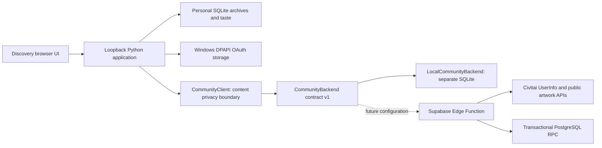

# Discovery 3.0 development architecture

Status: local development milestone, **3.0.0-dev**, branch `3.0`. No cloud
resources provisioned, no GitHub push, no release published. Source baseline:
`7e789457c30461ce7135aaa9729895a39fc692e8` from the official repository.

## ADR 001: local Discovery with a small shared community backend

Decision: keep personal archives, taste analysis, OAuth credentials and all existing
Discovery features on each computer. Add an optional community service for canonical
recommendation records and quotas. Retire the architectural dependency on a hosted
Discovery VM; there is no work here on the previous Discovery/Common Room services.

This preserves offline access to personal data, avoids uploading taste histories,
reduces hosting scope, and makes a community outage independent of app startup.
The cost is a separate trust boundary: a distributed desktop client cannot enforce
shared quotas or attest to its own Civitai identity. The shared service must do both.

## Existing integration map

- `discovery/oauth.py`: Authorization Code + PKCE, fixed registered callback port
  8765, UserInfo, DPAPI encryption and token refresh synchronization. This flow is
  preserved. Legacy token/data migration is disabled for 3.0 development; the Linux
  keyring service name also has a separate 3.0 namespace.
- `discovery/social.py`: authenticated Civitai tRPC actions, protected Python token
  access, existing media and creator lookup procedures. No new registration flow.
- `server.py`: loopback HTTP routes, existing host/origin checks and bounded JSON
  bodies, personal gallery/taste/archive services. Community initialization is lazy;
  failures produce an isolated community error response without blocking startup.
  Normal protected OAuth is required for every Community route. Explicit automation
  uses a challenged, disposable sandbox, never the interactive profile. Thumbnail
  delivery checks current controls before serving cached bytes. Daily image previews
  and Community previews share bounded Pillow normalization and persistent caching;
  original video behavior remains separate. See [restoration findings](3.0-artwork-restoration.md).
- `static/ui/cards.js`: shared artwork cards, action menu, carousel and artwork
  presentation. A Recommend action opens the same single-modal submission flow
  used by paste-link submissions. Community cards reuse this component; their detail
  dialog uses viewer-allowed metadata; recommendation previews and commits require
  fresh authoritative artwork verification.
- `discovery/settings.py`, `discovery/taste.py`: existing browsing levels and content
  controls. Community reads the same browsing-level setting, uses account-scoped
  cached hidden controls with background refresh, and resolves tags before returning
  any preview to JavaScript. Local control actions update that snapshot immediately. Community
  uses the existing shared filter panel and save mechanism; it has no separate
  rating buttons or rating-selection state.

## Backend contracts and storage

`CommunityBackend.request(operation, token, payload)` is implemented by both
`LocalCommunityBackend` and `SupabaseCommunityBackend`. The local Python
`CommunityClient` wraps either adapter and owns preview resolution and viewer
filtering. The browser never selects or contacts an adapter directly.

Local simulator data lives in `community/local.sqlite3`; synthetic development data
uses `community/fixtures.sqlite3`. These databases are separate from personal taste
and archive databases. Recommendations contain globally unique image IDs, verified
creator and recommender IDs, a member credit, server acceptance time, UTC week and
status. An append-only application audit records acceptance, withdrawal and moderation.
Image binaries, image URLs, OAuth credentials, email and taste profiles are not stored
in the community database.

SQLite uses `BEGIN IMMEDIATE` to serialize quota checks and insertion across independent
connections. Connections close explicitly for Windows file lifecycle safety. This is
**not** a PostgreSQL concurrency or RLS simulation. Production uses advisory transaction
locks, uniqueness and separate database permissions; it has its own opt-in tests.

## Rules and product decisions

- Each verified member: three accepted artworks per Monday-to-Monday UTC week.
- Each verified creator: three distinct accepted artworks per UTC week across members.
- The week and acceptance time come from the backend clock, after acquiring write locks.
- Global artwork uniqueness persists across weeks, withdrawals and removals.
- Preview, rejected requests and retries rejected as duplicates spend no quota.
- Withdrawal/moderation retain the accepted row and its original quota usage.
- Moderation has an operator-only interface, with no browser moderation endpoint.
- Deleted, unavailable, private, unlisted, unsupported or unverifiable artwork is omitted
  at read time. Transient upstream failure fails the community read with a friendly
  error instead of returning stale previews. Reappearance is allowed if the upstream
  artwork becomes eligible again and the recommendation remains active.
- This milestone supports still images. Video/audio are explicitly rejected pending a
  reviewed thumbnail/rating contract; personal Discovery video support is unchanged.
- Reads require a Civitai identity in v1. Anonymous public gallery access is deferred.
- Removed recommendations remain reserved globally; restoring or allowing a new
  recommendation is a future moderation/product decision, not an automatic refund.

## Source verification and compatibility boundary

Inspected official documentation and source on 2026-10-14:

- [Official Images API](https://github.com/civitai/civitai-developer-docs/blob/ed97b91ae45165d63aa193a95a0c210bd291ebea/site/reference/images.md)
- [OAuth developer guide](https://github.com/civitai/civitai/blob/ee2852c6469c5bfd76be6d98070289e8e739c8a9/docs/auth/oauth-developer-docs.md)
- [Image router](https://github.com/civitai/civitai/blob/ee2852c6469c5bfd76be6d98070289e8e739c8a9/src/server/routers/image.router.ts)
- [Image controller](https://github.com/civitai/civitai/blob/ee2852c6469c5bfd76be6d98070289e8e739c8a9/src/server/controllers/image.controller.ts)
- [Image service](https://github.com/civitai/civitai/blob/ee2852c6469c5bfd76be6d98070289e8e739c8a9/src/server/services/image.service.ts)
- [Hidden-preferences wire shapes](https://github.com/civitai/civitai/blob/ee2852c6469c5bfd76be6d98070289e8e739c8a9/src/shared/hidden-preferences/compact.ts)

The REST list response supplies `items`, an exact image ID, username, `browsingLevel`
and an image-host URL, but does not document a numeric creator ID. Therefore REST
alone cannot enforce no self-promotion. The upstream public `image.get` tRPC procedure
returns `user.id`, `user.username`, availability, ingestion and publication fields.
Require both responses to agree; require public, scanned, published still artwork,
no review/block flags, and a known precise browsing level. Resolve votable tags before
viewer filtering. Support SuperJSON and flattened tRPC serialization; unexpected
schemas fail closed. Artwork API reads now use the protected OAuth bearer on fixed official hosts: live anonymous calls failed authentication. Explicit public availability, publication, ingestion and moderation checks remain mandatory even when the token can access private artwork. The token never reaches the CDN.

Both legacy and compact-v2 hidden-image sets are accepted, including implicit tag-vote
image hides and users blocked in either direction. Unknown control versions or
malformed control sets fail closed; they never mean an empty filter.

**Compatibility limitation:** tRPC is implemented in the official upstream and is
already used by Discovery, but is not a versioned stable REST guarantee. Before public
rollout, verify the pinned contract against live Civitai using designated test accounts.
The October 15 follow-up verified real UserInfo and six public artwork ownership/tag responses using the existing session, without creating recommendations or modifying Civitai content. Dedicated-account revocation and deployed Edge validation remain outstanding. If an upstream
response omits owner/availability/rating data, reject it rather than guessing from a
username or accepting a successful HTTP status as proof.

## Security boundaries

Browser inputs contain only an artwork reference or pagination cursor. IDs and exact
approved HTTPS page URLs are strictly parsed; ports, queries, fragments, credentials,
escaped IDs and other domains are rejected. The parsed numeric ID is interpolated into
fixed official API destinations. Redirects are refused, each network request has an
8-second timeout, response reads are bounded, and there are no automatic retries.

Python alone retrieves OAuth access tokens from the existing protected credential store.
The Edge Function independently calls UserInfo on **every authenticated request**. No
community session cache is introduced, making revocation behavior straightforward.
Only numeric identity and a display credit are retained; extra UserInfo claims are discarded.
The local service uses short-lived request/member rate buckets; production uses persistent
short-lived token digests and member buckets. Edge perimeter/IP protection is a deployment
requirement against floods of random invalid tokens, not something a desktop can enforce.

The desktop now caches gallery/status responses and public artwork metadata for 24
hours, rendering stale records while refreshing in the background. This does not
create a shared-service session or authorize a write: every request reaching the
Edge Function still performs its own checks. See [persistence behavior and validation](3.0-persistence.md).

The distributed application contains no service-role key or database password. All
privileged SQL is server-side. RLS denies ordinary roles; complex quotas are enforced
in the transactional function, not by RLS alone. Community errors and logs never expose
upstream request objects, access/refresh tokens, raw exceptions or credential records.

## Local improvements found outside this clone

Read-only inspection located the 2.x working tree at
`<2.x checkout>`, HEAD
`83d59518a2c87d3ac67e2de105fa9151c2ba2ab6`. Its existing uncommitted changes were
**not imported or modified**:

| File | Existing improvement absent from official main |
| --- | --- |
| `discovery/capture.py` | Uses actual 12-hour bounds for automatic morning/evening captures instead of whole-day bounds. |
| `discovery/history.py` | Adds an explicit, backup-required repair routine for historical wrong-half memberships; ordinary startup does not run it. |
| `static/app.js` | Restores a saved gallery without forcing a rebuild. |
| `tests/auto_capture.py` | Asserts exact segment boundaries for automatic captures. |

These deserve a separate reviewed follow-up. The known upstream automatic half-day
boundary issue is not repaired here. No runtime databases, configuration, logs or
credentials were read or copied from that installation.
